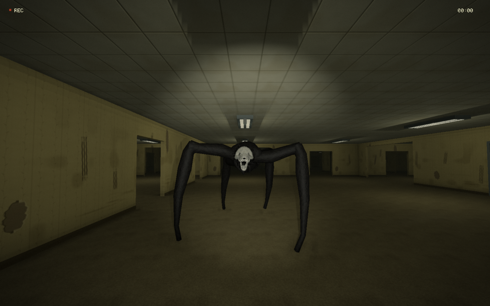

# BACKROOMS / Threshold v0.12 — Aranea Membri update

An effectively endless, connected yellow interior in **C++17 and OpenGL 3.3 core** for the Computer Graphics Fundamentals project. Explore worn rooms, repeating corridors and open halls with smooth first-person controls, stamina, interactive doors and spatial sound. One four-legged Aranea Membri creature wanders the level, hears movement and chases when it detects you. Break contact, hide and follow optional clues toward an exit.



*The current four-legged Aranea Membri, captured in-game.*

## Aranea audio update — 13 October 2026

- **Soil footsteps:** separate walking and running banks use Fantozzi's CC0 sand recordings, with a soft impact and ground rustle. The hard clank and extra toe click were removed. Four variations per gait follow the creature's animated foot contacts and actual movement speed.
- **Sighting screams:** the creature screams when it sees the player, including when sound has already started a chase. Sustained visual pursuit repeats a call about every seven seconds; collecting the key enables the periodic rage roar. A cooldown limits repeated detection calls.
- **Audible distant calls:** screams carry farther than footsteps and take priority when the mixer is busy. Stereo direction, distance, walls, closed doors, master volume and mute still affect them.
- **Reliable playback:** resuming from pause preserves cues triggered on the first frame. The complete 16-clip bank loads before gameplay; player footsteps and the capture sound retain their existing recordings.

The expanded audio tests, rebuilt game and five automated gameplay scenarios passed, covering walking, chasing, pause, key pickup and capture/restart. See [audio implementation and verification](docs/aranea-audio.md), [asset sources](assets/audio/aranea/README.md), and the bundled [sound preview](assets/audio/aranea/preview.wav).

## Play on this Windows computer

1. If you cloned or downloaded the source from GitHub, follow [Build from source](#build-from-source) below first. Then open **Backrooms.exe** in the built project folder.
2. Click **Enter the Backrooms**, or select it with **Up/Down** and press **Enter**.
3. Use **WASD** and the mouse. Press **Escape** to pause and release the cursor.

The GitHub repository contains source code and assets; the build produces `Backrooms.exe`. The local Desktop copy already contains this executable. Keep the seven `.glsl` files and the complete `assets/` directory beside it. No batch launcher is required. Project code generates environment textures, normal maps and ambient sound; footsteps use the bundled recordings credited in [THIRD_PARTY.md](THIRD_PARTY.md). The user's supplied **“Numbers” by Temporex** plays as background music. The game requires no photo assets or runtime downloads. If it cannot start, read `backrooms.log` and confirm that the graphics driver supports OpenGL 3.3.

## Controls

| Control | Action |
| --- | --- |
| Up/Down + Enter, or mouse click | Select and activate main/pause menu items |
| Enter, with the play/resume option selected | Begin / resume; continue exploring after reaching the exit |
| Enter or click Restart Run, after being caught | Restart the same seeded building with fresh stamina, doors and creature state |
| WASD + mouse | Move and look |
| Left Shift | Sprint while stamina is available |
| Hold Ctrl | Crouch; lower the camera and walk quietly |
| E | Enter/leave a nearby hiding place, or open/close a door |
| F | Toggle flashlight |
| C | Toggle flashlight-revealed clues |
| Tab | Toggle local map |
| H | Reopen the controls popup |
| V | Toggle minimal camera HUD |
| M | Mute / unmute all sounds |
| O, in the main/pause menu | Open settings |
| Left/Right, in settings | Adjust the selected setting; mouse minus/plus controls also work |
| F1 | Show performance and world diagnostics |
| F2 | Show wireframe geometry |
| F3 | Enable/disable changes to distant unseen rooms |
| R | Return to the first room, keeping the seed |
| N, while paused | Start a different seeded building |
| F12 | Save a BMP screenshot to `captures/` |
| J | Trigger the debug jumpscare |
| Escape | Pause / resume and release / capture mouse |
| Q, while paused | Quit |

Walking reaches **2.5 m/s**, Shift reaches **4.0 m/s**, and crouching reaches **1.1 m/s**. Acceleration and braking give movement weight. Holding Ctrl eases the eye height from 1.65 to 1.08 metres. Footsteps follow actual travel: crouching stays quiet, and wall pushing does not keep playing walking sounds. **M** mutes the complete sound mix.

Controls appear in a three-stage illustrated guide at the start of each run:
movement, exploration and survival. Click **Next** or press **Enter** to advance;
**Back** and the left arrow return to the previous page. **Begin Exploring** on
the final page closes it. **Escape** or the corner close button skips the guide;
**H** reopens it. The world and audio pause while it is open, and the cursor is
free. Nearby interaction prompts remain on the HUD.

Wall hiding pockets have metal ventilation covers: **E** enters behind the cover
or leaves it, and real gaps between the slats let you watch the corridor. Closed
covers block ordinary walking. Doors now have procedural brown wood grain. A
bright neutral-white ceiling panel illuminates the exit vestibule.

A small brown mouse wanders the floor and scurries away when touched. Its
positional squeak alerts the creature to that location, including during the
initial spawn grace period. Walls and distance limit an active creature's
hearing. Continuous contact cannot repeatedly trigger the squeak; stepping away
rearms it after a short cooldown. See [room details](docs/room-details.md).

Stamina starts at **100**, drains at **18 points per second** during actual sprint travel, and recovers at **14 points per second** after **1.5 seconds** without sprinting. Exhaustion prevents sprinting until stamina recovers to **22**. Pausing freezes stamina. Doors swing smoothly through **90° in about 0.8 seconds**. Their collision follows the moving panel; an obstructed closing door reverses instead of trapping the player. Pausing also freezes door movement. Reserved connecting routes remain traversable.

Mouse look is smoothly eased, and restrained head bob follows actual movement. The default camera has light soft focus and a field-of-view change from **78° to 82°** during sprint travel. Version 0.10 reduces the blur radius from 1.7 to **0.8 reference pixels** at the image centre, roughly halving the previous softness while keeping existing settings. The interface remains sharp. Rooms have dim fluorescent lighting and deep shadows; use **F** to toggle the flashlight. V hides the ordinary navigation HUD for a cleaner camera view; it does not record video.

The clickable main and pause menus provide play/resume, settings, a new seed, a return to the entrance and quit. Settings include **mouse sensitivity, master volume, music on/off, music volume, brightness, field of view, head bob, camera softness and VSync**, plus **Contact Shading** (0–100%, default 65%) and a reset-defaults option. Music volume defaults to **35%**, multiplied by master volume. Changes are saved to `settings.cfg` beside the executable. Head bob and camera softness can be set to zero. Press Escape in settings to return to the menu.

The yellow wallpaper and acoustic-ceiling style continues through classic rooms, repeating corridors, open halls, pillar halls, dead ends and occasional odd rooms with hard tiled floors. Layouts vary across **7.5, 15 and 22.5 metre** footprints under a uniform 3.2 metre ceiling. Procedural wall scars, peeling patches and damp marks combine with normal-mapped wallpaper, dry/damp carpet, ceiling tiles and hard flooring. The connected world continues generating as you walk. The older photo Nextbots and separate themed districts remain removed. Seeded recesses carved into existing yellow walls provide hiding places; **H** marks them on the minimap. Approach and press **E** to hide or leave. Break the creature's line of sight before entering. Hiding stops movement, lowers the camera, and suppresses the flashlight while allowing you to look out.

The Aranea animation update replaces the humanoid with the supplied four-legged creature. A staggered walking gait lifts one leg at a time while three support the body; running uses faster diagonal pairs. The body turns before moving, the head stays centered during locomotion and tracks independently while idle, the jaw moves, and step sounds follow all four foot contacts. The legs fold inward for doorways. See [Aranea animation and validation notes](docs/aranea-motion.md). The [earlier Smiler animation results](docs/smiler-motion.md) are historical and do not validate this replacement.

The **Aranea Membri** uses the actual 3D mesh from the user-supplied `rec-room-backrooms-entity-62-aranea-membri.zip`, including `source/Scene.glb` and its two carpet textures. All 135 mesh parts and 15,220 triangles are retained. The source has no rig or animation; the project adds four articulated leg chains, head/jaw movement, walk/run cycles and a capture pose. Offline conversion produces `assets/models/aranea/aranea.brm` and two texture caches, so Blender and Python are not needed to build or play. Source provenance and rebuild instructions are in the [model notes](assets/models/aranea/README.md). This replaces the previous Smiler; its earlier source and animation remain in local backups. After an initial **8-second grace period**, one creature can enter unseen, reachable space **16–22 metres** from the player. Walls and closed doors block its sight; obstructions reduce its hearing range. Crouching is quiet, sprinting is louder, and nearby door interactions can reveal your position.

Before the key is collected, the creature runs faster than walking speed but slower than the player's sprint. When contact is lost it searches the last sensed position, giving up after about **5 seconds** without seeing or hearing you. It navigates around walls and pillars, folds its legs through doorways and cannot catch through a closed door. Its corrected skull and body both face forward: it turns before moving along a new route segment, and its head stays centered while walking or running. Positional footfalls help you hear its direction during a chase.

Contact or unobstructed proximity within **1.5 m** triggers a **2-second 3D jumpscare**, then **0.3 seconds of black** before Game Over. The camera turns toward the animated head over **0.20 seconds** with ease-out. The creature faces the camera and lunges to an eye-anchor distance of **0.90 m**, with a large close-up, reaching claws and head jitter. Random camera shake and roll fade over time, while FOV punches from **70° to 95°**. Edit `jumpscare.cfg` and restart to change duration, distance, timing and effects; `--jumpscare-config` selects an alternative file. **J** triggers a debug scare. See [jumpscare settings and implementation](docs/jumpscare.md).

Click **Restart Run** or press **Enter** with that option selected to restart the same seed. Restart restores stamina and resets the creature and doors; settings remain saved. **Main Menu** prepares a fresh run with the same seed and leaves it paused at the menu. Escape cannot resume a defeated run. Music pauses during capture and the game-over screen. **M** and master volume also apply to the jumpscare sound.

Ceiling fixtures have seeded **working, dying or off** states. Working lamps fluctuate gently, dying fixtures flicker more strongly, and off fixtures contribute no light. Each selected local light uses distance attenuation and cached shadows from walls, frames and doors. The flashlight provides a separate directional beam with filtered shadows, including the animated creature.

Sound uses the existing Windows **WinMM** output API, with no additional library. The stereo mixer pans world-space sources relative to the camera and attenuates them using their three-dimensional distance. The nearest active fluorescent fixture hums; seeded distant creaks and drips add ambience. The player uses the supplied freesound indoor footsteps uniformly on every floor; gait still controls cadence and volume. Aranea has separate ground walk/run contacts, a scream on seeing the player and lower pursuit calls, with four variants each. Footfalls follow the four animated feet; calls and steps use distance and wall/closed-door attenuation. See [Aranea audio](docs/aranea-audio.md) for the user's reference and processing. A subdued drone and occasional electrical stinger respond to environmental tension. Capture retains the user-supplied roar with a low impact, exclusive playback and controlled headroom. Ambient and door cues remain generated placeholders. All sound banks are cached before gameplay; source excerpts and conversion manifests are retained.

The soundtrack plays from `assets/audio/music/numbers-temporex.mp3`, converted locally from the supplied file for compatibility with this computer's Windows decoder. The original `numbers-temporex.m4a` is preserved in the same directory. Windows WinMM/MCI plays the music separately from positional environmental sounds, without another runtime library. Pause, **M**, or switching music off pauses the track; resuming keeps its playback position. Music volume can be lowered independently of footsteps and ambience. The generated audio-preview WAV contains the environmental mix, not the song.

The green **EXIT SIGNAL** shows distance and direction relative to your view. The exit is fitted into a wall opening at `(6.225, -267)`, with its approach near `(6.225, -265.8)`, about 270 metres north of the entrance. The exit starts **locked**. Follow the gold **KEY SIGNAL** and minimap marker to the seeded brass key. Walk close to collect it: the exit opens, the creature becomes **35% faster**, and it roars. Then follow the clear north route and **walk through the open doorway** to escape. The collected key persists while rooms stream; a new run resets it. See [key, hiding and audio details](docs/key-and-hiding.md). Pressing E alone does not end the game. The **YOU ESCAPED** screen pauses play; **Enter** continues exploration. The local map shows the exit when it is in range.

To see the first clue, stand in the starting room, face its first north doorway, and aim the flashlight at the doorway's left side. Toggle F to compare.

## Features in version 0.12

- Seeded, connected yellow rooms, corridors, halls, pillars, dead ends and occasional tiled rooms.
- Smooth mouse look, gradual acceleration/braking, adjustable head bob, crouching, stamina and collision sliding.
- Animated hinged doors, a farther wall-integrated exit about 270 m from the entrance, and flashlight-revealed clues.
- The supplied textured 3D Aranea Membri with four-legged walk/run animation, independent head/jaw movement, 16–22 m spawns, sight/hearing detection, collision-aware pursuit, last-position searching and a timed loss of interest.
- A 3D capture jumpscare, Aranea ground footsteps and sighting/pursuit calls, game-over screen and same-seed restart.
- Procedural worn materials with UV mapping, mipmaps and normal maps.
- Working/dying/off fluorescent fixtures, per-light attenuation, cached six-face lamp shadows, PCF-filtered flashlight shadows, Blinn-Phong shading and distance fog.
- Half-resolution, depth-aware contact shading with adjustable strength, plus restrained paper, carpet and ceiling wear.
- An offscreen scene framebuffer with light soft focus, analog grain and vignette, followed by a sharp HUD.
- Stereo spatial hum, distant ambience, environmental tension, door sounds, universal player footsteps, wall-attenuated creature soil contacts and calls, and the supplied Temporex soundtrack.
- Main/pause menus and persistent camera, audio and display settings.
- Bounded room streaming, origin rebasing for distant travel, local map and rendering diagnostics.

Room loading keeps **25 playable chunks** and at most **24 prepared neighbours**. Each chunk has 6 × 6 cells, each 7.5 metres wide, for a **45 × 45 metre** chunk. One nearby chunk is prepared per frame and its mesh can upload before it becomes active. Unchanged nearby chunks can be reused on a turn back. GPU synchronization limits queued rendering work. Audio uses cached clips and at most 12 overlapping one-shot voices.

Initial loading, teleports and cache misses can still generate geometry synchronously. Read the measured results and their limits in [verification.md](docs/verification.md). The base world regenerates from its seed. Temporary room changes reset after their chunk unloads; at most 128 opened-door overrides are remembered, after which the oldest return to their seeded state when regenerated. “Endless” means continuing generation within finite numeric limits and bounded memory.

## Build from source

The working setup on this computer is **MSYS2 MinGW64 GCC + GLFW**. The build script locates it at `C:\msys64\mingw64`, or uses `BACKROOMS_CXX` / a suitable compiler on PATH.

Close the game before rebuilding. From the project folder, run:

```powershell
powershell -NoProfile -ExecutionPolicy Bypass -File .\build.ps1 -Test
```

On a fresh Windows machine, install MSYS2 and these packages from its **MinGW64 terminal**:

```sh
pacman -S --needed mingw-w64-x86_64-gcc mingw-w64-x86_64-glfw
```

GLAD support files are included in `common/` and `include/`. The build script statically links GLFW and the MinGW runtime. Windows system libraries and a compatible graphics driver remain required. Its PATH change applies only to its own process.

Alternative course-style build definitions are supplied:

```sh
make
make test
```

```sh
cmake -S . -B build
cmake --build build --config Release
ctest --test-dir build --output-on-failure
```

The primary verified build is the Windows PowerShell route. Other toolchains require testing on their target machines. CMake copies the runtime shaders and assets beside its executable, including the converted creature mesh and audio.

## Source organization

The structure follows the familiar BR_A1 arrangement of root source/shader files, `common/` and `include/`.

```text
Backrooms CGF Project/
  backrooms.cpp              Application, input, camera, rendering and HUD
  world.cpp / world.h        Generation, streaming and collision
  vshader_backrooms.glsl     Model / view / projection vertex stage
  fshader_backrooms.glsl     Textures, local lighting, flashlight and fog
  vshader_lens.glsl          Fullscreen postprocess vertex stage
  fshader_lens.glsl          Soft focus, depth-aware contact shading, grain and vignette
  vshader_shadow.glsl / fshader_shadow.glsl   Flashlight and cached lamp depth maps
  fshader_ao.glsl            Half-resolution screen-space contact occlusion
  common/graphics.h         Shadow/AO targets and lamp face transforms
  common/gameplay.h         Movement speed and field-of-view settings
  common/movement.h         Acceleration and braking
  common/player_state.h     Stamina and smooth mouse-look state
  common/threat.h / .cpp    Single-creature sensing, navigation and behavior
  common/threat_model.h/.cpp Converted Aranea mesh, four-leg clips and capture pose
  common/settings.h         Validated persistent user settings
  common/audio.h / .cpp     Recorded steps, cached spatial mixer and Windows playback
  common/music.h / .cpp     Supplied soundtrack playback through Windows MCI
  common/                   Math, shader loading, textures, UI and GLAD
  include/                  Generated GLAD and Khronos headers
  tests/                    CPU tests and graphics verification evidence
  assets/audio/footsteps-player/   Supplied universal player contacts
  assets/audio/footsteps-monster/  Previous heavy contacts and fallback
  assets/audio/aranea/       Soil walk/run, sighting and pursuit banks
  assets/audio/music/        User-supplied Numbers by Temporex
  assets/models/aranea/      Supplied GLB, PNGs, animation bank and RGB texture caches
  tools/bake_aranea.py       Offline four-chain IK and head/jaw animation baker
  tools/aranea-rig.json      Original mesh-part joint and pivot mapping
  tools/prepare_aranea_textures.py   Offline texture-cache converter
  tools/prepare_aranea_audio.py     Offline audio-bank rebuild from retained sources
  tools/verify-aranea-audio.ps1     Automated audio gameplay scenarios
  assets/                   In-game preview and exported audio preview
  docs/                     Report draft, slides, demo and learning guide
  build.ps1                 Windows build and test
  settings.cfg              User preferences, created when settings change
  jumpscare.cfg             Optional capture duration, camera, lunge and effect settings
  Makefile / CMakeLists.txt  Alternative build definitions
```

## Verification and demonstration

Read [verification.md](docs/verification.md) for executed checks and their limits. Automated captures can run without taking over the desktop:

```powershell
.\Backrooms.exe --hidden --demo --frames 120 --capture assets\test.bmp
.\Backrooms.exe --seed 42 --hidden --demo --frames 120
.\Backrooms.exe --demo --x 6.225 --z -265.8 --yaw -90
.\Backrooms.exe --audio-preview assets\audio-preview.wav
```

For this model replacement, `build.ps1 -Test` covers native behavior and model checks, and `tools/verify-aranea.ps1` exercises walk/run poses, head turns, door folding, live footfalls, pause, capture and restart. See [Aranea notes](docs/aranea-motion.md) for the current validation status. Install the rebuilt executable, `aranea.brm` and both Aranea `.rgb` caches together; the previous Smiler bank is not compatible.

For the current creature audio, run these from the project folder after building the tests:

```powershell
.\tools\verify-aranea-audio.ps1
.\tests\audio_tests.exe --aranea-preview tests\artifacts\aranea-soil
```

The mixer preview contains walking, running, a detection scream at 14.32 metres and a pursuit call at 22 metres. It uses master volume 0.75 without normalization. The separate `assets/audio/aranea/preview.wav` demonstrates the source bank without world attenuation. Rebuilding those assets with `python tools/prepare_aranea_audio.py` requires NumPy only for offline processing; playing the game does not.

The 12-second stereo sound preview demonstrates carpet walking, damp-carpet crouching, hard-floor sprinting, left/right ambience and environmental tension. It mixes the bundled footstep recordings with generated sounds and does not record a playthrough. Supporting materials:

- [Course requirements and status](docs/requirements.md)
- [Report draft](docs/report-draft.md)
- [Earlier presentation](docs/presentation.html), a historical v0.8 deck to update before demonstrating v0.12
- [3–6-minute demo script](docs/demo-script.md)
- [Learning guide](docs/learning-guide.md)
- [AI assistance disclosure](docs/AI_USE.md)
- [Third-party licenses](THIRD_PARTY.md)

## Scope and remaining work

This version combines exploration with one simple threat. It has no photo sprites, separate themed districts, furniture, weapons, network play or saved gameplay sessions. The creature uses bounded local pathfinding and a short memory, without complex tactics or a general-purpose navigation system. Settings persist, but world progress does not. Direct lamp and flashlight lighting use shadow maps; small ambient fill remains, without full global illumination. Audible spatial playback uses stereo panning and distance attenuation plus direct-ray wall attenuation for creature sounds, without HRTF filtering or acoustic propagation; the creature's hearing uses a separate obstruction-based detection rule. Normal maps change shading, not geometry. The exit presents an ending screen. Initial loading and cache misses remain synchronous, and procedural architectural motifs repeat.

This educational prototype includes substantial Codex assistance. Review and adapt the implementation, record student contributions and be able to explain it. The supplied syllabus's restrictions and disclosure requirements still apply. Team details, the official report template, defence date and final instructor rubric remain to be confirmed before an assessed submission. Nothing has been submitted to Moodle.

## Lighting and material update — 11 October 2026

The flashlight now casts filtered shadows from room geometry, swinging doors,
ventilation slats and the animated creature. Its emitter sits slightly below and
to the right of the camera, making nearby shadows visible. It returns to the
camera position when that offset would penetrate a wall.

Each of the selected ceiling lights has six cached 256px depth views. Walls,
frames, grilles and live door panels block its direct light; moving a nearby door
or changing nearby streamed geometry refreshes that light's cache. Lamp flicker
changes intensity without rebuilding the depth maps. Small ambient fill remains.

Contact Shading adds restrained screen-space occlusion in corners and joints.
Set it to zero in Settings to disable its rendering pass. Paper, carpet and
ceiling variations retain the existing yellow palette, layout and texture banks;
rare wet patches use lighting highlights rather than mirror reflections.

Follow-up fixes removed the repeating screen-grain grid and vertical contact-shading bands on angled walls. Grain now uses integer hashing, while contact shading uses matching depth texels and pixel centers with depth-aware upsampling. The existing wallpaper textures and visual style are preserved.

See [graphics-update.md](docs/graphics-update.md) for measurements and limitations.
Use `build.ps1 -Test -GraphicsTest` for native tests and rendered shadow/AO probes.
