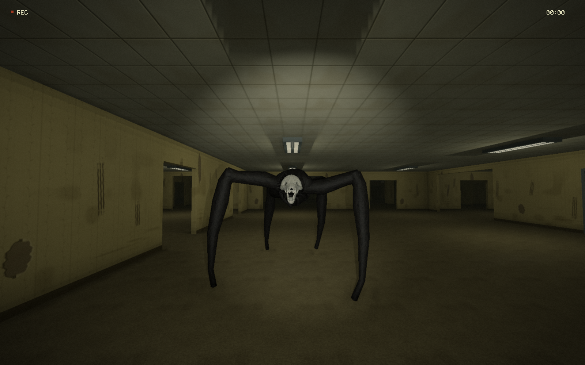
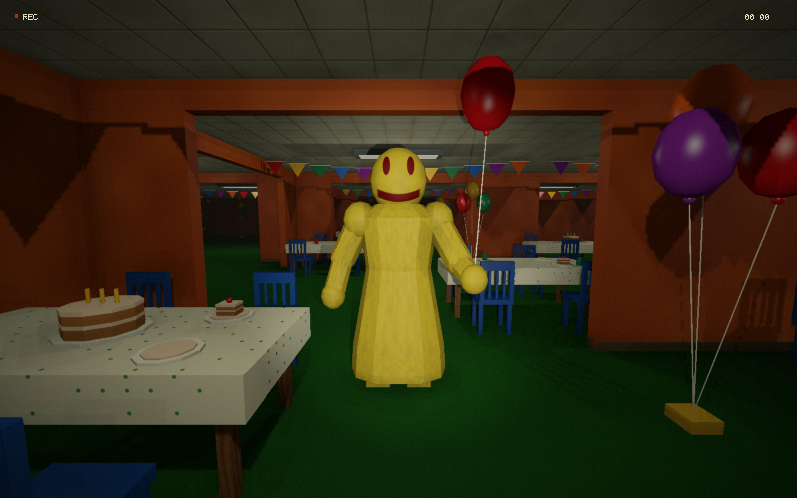
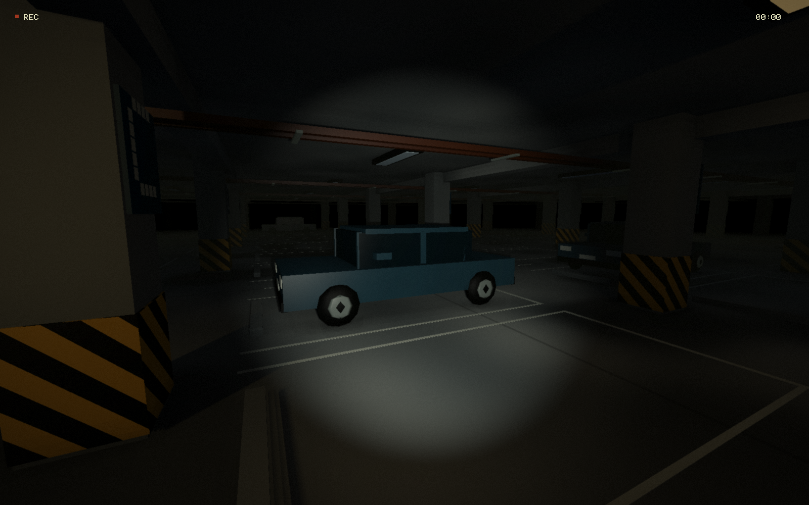
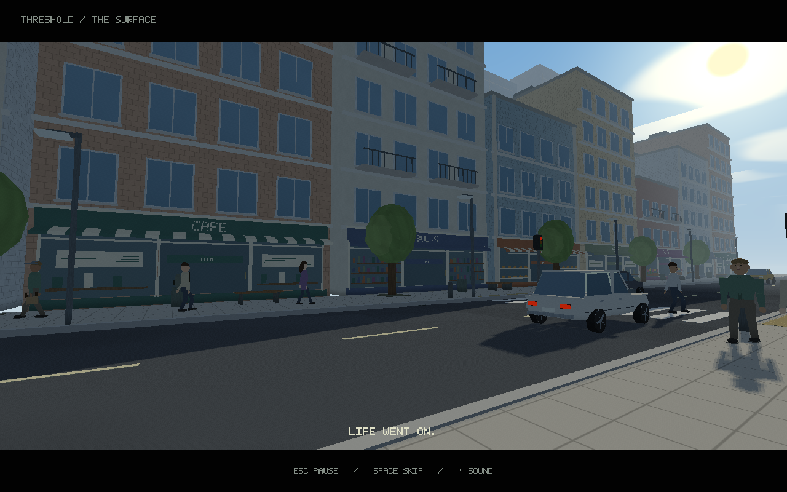

# BACKROOMS / Threshold v0.12

A first-person horror exploration game built with **C++17 and OpenGL 3.3** for the Computer Graphics Fundamentals project. Explore seeded procedural rooms, manage stamina, escape creatures and find a way to the surface.

## Play

Open **Backrooms.exe** in a built copy of the project. Keep `assets/`, the `.glsl` shaders, `balance.cfg` and `jumpscare.cfg` beside it. Windows and a graphics driver supporting **OpenGL 3.3** are required.

A GitHub clone contains source code and assets; **the EXE is not included**. Follow [Build from source](#build-from-source) below. If startup fails, check `backrooms.log`.

## Levels

**Yellow Rooms → Level Fun → Underground Parking → City ending**

### Yellow Rooms / Level 0

Find the brass key and reach the exit while avoiding **Aranea Membri**, a four-legged creature that reacts to sight and sound. Break line of sight and use hiding places.



### Level Fun

Search presents for the exit key. **Partygoers** freeze when visible and chase when you look away.



### Underground Parking

Restore circuits **A, B and C**, then open the service exit. Use the flashlight to repel the eyes approaching through the darkness.



### Elevator to the surface

The final exit starts an animated elevator ride into a city with pedestrians, traffic, sunlight and shadows.



All screenshots are captured in-game. **Escape → Choose a Level** starts any stage with fresh progress. Settings are saved; gameplay progress lasts only for the current session.

## Controls

| Key | Action |
| --- | --- |
| WASD + mouse | Move and look |
| Hold Shift / Ctrl | Sprint / crouch |
| E | Interact with doors, hiding places, presents, notes and cabinets |
| F | Toggle flashlight |
| C / Tab | Toggle clues / map |
| Escape | Pause, settings and level selection |
| H | Open the controls guide |
| M | Mute / unmute sound |
| F1 | Performance diagnostics |
| F9 | Preview the ending; Space skips it |
| F12 | Save a screenshot in `captures/` |

Settings include mouse sensitivity, volume, music on/off, brightness, field of view, head bob, blur and an FPS limit.

## Build from source

On Windows, install **MSYS2**. In its **MinGW64 terminal**, install the build dependencies (CMake 3.21+):

```sh
pacman -S --needed mingw-w64-x86_64-gcc mingw-w64-x86_64-glfw mingw-w64-x86_64-make mingw-w64-x86_64-cmake
```

From the project folder in PowerShell:

```powershell
.\build.ps1 -IfNeeded                 # Build Backrooms.exe
.\build.ps1 -Test -GraphicsTest       # Build and run native/OpenGL tests
.\Backrooms.exe                      # Play
```

After `git pull`, close the game and rebuild. **Run.cmd** rebuilds and launches the game when the development tools are installed. CMake supplies the shared build rules; see the [build and test guide](docs/build-and-tests.md) for Linux, presets and CI.

## Code and documentation

- [Code structure and current verification](docs/code-structure.md) — game loop, movement, interactions, rendering and level transitions.
- [Gameplay tuning](docs/balance.md) — edit `balance.cfg` and restart; no recompilation needed.
- [Performance diagnostics](docs/performance.md) — memory/resource reports and repeated-level checks.
- [Controls and ending](docs/ending-elevator.md) — cinematic playback and replay.
- [Course requirements](docs/requirements.md), [report draft](docs/report-draft.md) and [demo guide](docs/demo-script.md).

This educational project was developed with Codex assistance; see [AI-use disclosure](docs/AI_USE.md). Model, audio and library sources are documented in [Third-party credits and licenses](THIRD_PARTY.md).
